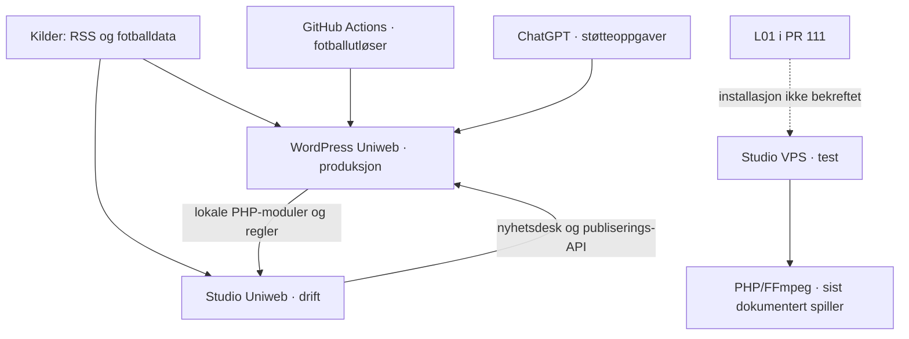

# Arkitekturgjennomgang for Radio Rubben

WordPress som redaksjonelt grensesnitt, Robåt som bakgrunnsmotor og Studio som lydsystem

24. oktober 2026 · Utvidet 25. oktober 2026 · Versjon 1.2 · Europe/Oslo

**Anbefaling:** Viderefør denne ansvarsdelingen, med gradvis utskifting av eksisterende koblinger. WordPress skal eie redigering og redaksjonelle beslutninger. Robåt skal utføre kildearbeid og generering på VPS. Studio skal eie lydproduksjon, bibliotek, sendekø og avvikling. Gjenbruk dagens PHP-kode og kontroller. Studio #109/L01 beholder førsteprioritet; robotflytting skal ikke bli en forutsetning for teststrømmen.

**Leveransestatus 25.10:** Utvidet funksjonskart, faktisk WordPress-inventar, schedulerregister, eierskap, foreløpig API-kontrakt og migreringsvilkår står i kapittel 10–15. Første avgrensede kodeforbedring er levert i eksisterende Studio #111, commit `a346ebc2c3e234daaa72819a3a4843cd1d67e0b1`. Ingen produksjonsendring, tjenesteoppstart, innholdspublisering, modellkjøring eller merge inngår. API-ene og migreringen er fortsatt forslag. Arbeidsområder: System & Kvalitet, Teknisk Produksjon, Manus & Stikk og Lokalt Engasjement.

## 0 Miljøer og navn – presisering 25.10.2026

Dagens Studio på Uniweb og Studio under utvikling på VPS er to installasjoner med forskjellig driftsstatus. Samme repository eller sidenavn innebærer ikke samme installerte versjon, konfigurasjon, data, kø eller rettigheter. Bruk navnene nedenfor i oppgaver, PR-er, status og utrullingsplaner; de er dokumentasjonsnavn, ikke nye konfigurasjonsverdier.

| Entydig navn | Plassering og nåværende rolle | Avgrensning |
| --- | --- | --- |
| **WordPress Uniweb – produksjon** | `https://www.radiorubben.no`. Dagens nettsted med publisert innhold, Fotballrobot og øvrige WordPress-funksjoner. | «WordPress» alene angir ikke et testmiljø. Produksjonsinnhold og eksisterende godkjenningsflyter bevares. |
| **Studio Uniweb – drift** | `https://studio.radiorubben.no`. Eksisterende PHP-applikasjon på samme webhotell som WordPress, med dagens nyhetsdesk, RSS-/manusflyter og øvrige Studio-funksjoner. | En egen applikasjon, ikke det samme som WordPress eller VPS-Studio. «Drift» betyr at løsningen er i bruk, ikke at den avvikler en radiosending. Eksisterende CRM og andre funksjoner har ingen besluttet flytting i denne presiseringen. |
| **Studio VPS – test** | Separat installasjon på test-VPS. Eksisterende testlenke er `https://5.249.252.78/music-studio.php`. #109/L01 gjelder bibliotek, musikkø, avspilling og teststrøm her. | Under utvikling og kontroll. Testlenken er en miljøreferanse fra brukerens test, ikke en ny tilgjengelighets- eller lydkontroll. Installasjonen har ikke overtatt rollen eller domenet til Studio Uniweb – drift. |
| **Robåt VPS – planlagt bakgrunnsmotor** | Mål for gradvis flytting av kildehenting, generering og kontroller. | En komplett selvstendig bakgrunnsmotor er ikke dokumentert i drift. Dagens robotarbeid er fortsatt fordelt på WordPress, Studio Uniweb og eksterne automatiseringer. |

En separat WordPress-instans på test-VPS må også omtales med eget miljønavn og verifisert adresse når den brukes. Ingen produksjonsadresse skal brukes som plassholder for denne. Den konkrete testinstansens adresse og aktuelle tilstand er ikke kontrollert i denne dokumentasjonsendringen.

ChatGPTs tidsstyrte oppgaver er eksterne støtteoppgaver. De er verken WordPress-pluginen eller en VPS-tjeneste, og må registreres med hvilket miljø de leser eller skriver i. «Radio Rubben Robåt» kan brukes som samlebetegnelse for robotarbeidet; et samlenavn flytter ikke kode, data eller jobbansvar.

### Arbeidsregel for videre oppgaver

- Oppgi alltid **komponent, miljø, konkret adresse/instans, repo og gren/commit, berørte data og ønsket resultat**. «Oppdater Studio» eller «roboten kjører» er ikke en tilstrekkelig teknisk målbeskrivelse.
- Rapporter **kode/PR**, **installert i navngitt miljø** og **verifisert resultat i samme miljø** hver for seg. En test på VPS bekrefter ikke funksjon i Studio Uniweb, og en vellykket jobb i WordPress bekrefter ikke at Robåt er flyttet.
- Avklar én eier per jobb og én autoritativ original per datatype før overføring. Testkopier gir ingen rett til å skrive til produksjon; verifiser målendepunkt og miljøets data/nøkler før kjøring.
- Bevar Studio Uniweb – drift under utviklingen av Studio VPS – test. WordPress har dokumenterte lokale fil-/regelavhengigheter til Uniweb-Studio (A1); flytting eller stenging krever at disse først er erstattet og kontrollert.
- Målbildet i kapittel 1 beskriver senere ansvar. Det innebærer ingen automatisk flytting av dagens redaksjon, CRM, URL-er eller køer. Overgang skjer per funksjon med avstemte data, testbevis, konkret utrullingsautorisasjon og tilbakeføring.
- Studio #109/L01 på **Studio VPS – test** beholder førsteprioritet. Miljøpresiseringen oppretter ingen konkurrerende Studio-løsning eller ny robotimplementasjon.

**Kontrollgrunnlag for presiseringen:** Brukerens avklaring 25.10.2026, eksisterende kode-/driftsbelegg i denne gjennomgangen, fersk lesing av #109 og PR #114. Ingen ny serverkontroll, produksjonsendring eller endring av automatikk er utført.

## 1 Ansvar i målbildet

| Komponent | Skal eie | Grense mot de andre |
| --- | --- | --- |
| WordPress med redaksjonsplugin | Redigert nettsak og radiomanus, versjoner, kildevisning, redaksjonelle regler og beslutninger, publisering og rettelser | Sender bestillinger og viser jobbstatus. Utfører ikke lange modell- eller lydjobber i webforespørsler. |
| Robåt på VPS | Kildehenting, normaliserte fakta, originalutkast, kontrollrapporter, artikkel- og manusgenerering, jobbplan, omforsøk og feilkø | Leverer forslag og belegg. Har ikke myndighet til å publisere, endre en redaktørtekst eller styre sendingen. |
| Studio på VPS | TTS, uttale og stemmevalg, lydkontroll, mediebibliotek, programprofiler, musikkregler, køforekomster og sendelogg | Bruker et bestemt gyldig manusgrunnlag. Redaksjonell tekstendring går tilbake til WordPress og ny manusversjon. |
| Liquidsoap og Icecast | Programlyd og strøm, i egne prosesser under Studios avvikling | Skal kunne fortsette når redaksjonen eller Robåt er utilgjengelig. |
| OneDrive | Originalmedier, dokumenter og avtalt produksjonsarkiv | Serveren har lokale sendeklare filer. Arkivsynk skal ikke ligge i den tidskritiske avspillingskjeden. |

Det nyere oppdraget om WordPress som redaksjonelt grensesnitt presiserer retningen i grunnlag v1.3 og faktaarket fra tidligere samme dag, der Studio også var omtalt som redaksjonelt kontrollrom. Dette er en målendring, ikke en flytting som allerede er gjennomført. Eksisterende godkjenningsflater beholdes til erstatningen er testet. CRM og de øvrige Studio-funksjonene videreføres uten ombygging i denne leveransen.

Robåt beskriver her ansvaret for bakgrunnsjobber. Navnet innebærer ikke at den eksisterende TypeScript-grunnstrukturen allerede kan erstatte PHP-flytene. Behold de tre eksisterende kodebasene. Full omskriving, nytt monorepository, Docker og nytt frontendrammeverk inngår ikke.

## 2 Kartlagt eksisterende løsning

| Del | Kontrollert kode og dokumentasjon | Betydning for videre arbeid |
| --- | --- | --- |
| WordPress Fotballrobot | Webs selektive releasegrunnlag har kildeadaptere, FactStore, MatchJobs, MatchWork, Writer, EditorialQuality, PublicationGate, ReviewDesk, spillersaker og ukesdekning. [K2, K4] | Mye av motoren finnes allerede i PHP, men bruker WordPress-funksjoner og lagring. Den kan ikke bare kopieres ut og kjøres selvstendig. |
| Redaksjonell grense | ReviewDesk kontrollerer bruker, teksttoken og godkjenning. PublicationGate binder kvalitetskontroll til tekst, faktagrunnlag og regelversjon. [K4] | Bevar sperrene på serversiden når ny transport innføres. En vellykket AI-kontroll gir ikke publiseringstillatelse. |
| Samlet nyhetsdesk | Studio leser og avgjør WordPress-forslag via `/wp-json/rr-fotballrobot/v1/newsroom`. WordPress ReviewDigest laster samtidig Studios PHP-moduler fra lokal disk. [K5, K6] | Det finnes både API-kobling og direkte filavhengighet. De må skilles før Studio og redaksjonen kan frikobles. |
| RSS og manus i Studio | NewsDesk, newsroom, news-input, news-script og web-publish håndterer innhenting, relevans, originalkilde, nett-/radioutkast, godkjenning og levering. [K1, K6] | Gjenbruk funksjonene og kontrollene som grunnlag for Robåt. Beskytt eksisterende sakshistorikk. |
| Regler og lagring | Studio bruker `sending-board.json` med lås, revisjoner og atomisk erstatning. WordPress SharedRules leser godkjente fellesregler fra samme lokale fil. [K5, K6] | Delt filsystem er en reell driftsavhengighet. Senere regeloverføring må være versjonert og inkludere tilbakekalling. |
| TypeScript Robot | main har RSS-import/eksport, hendelser og en teknisk kvalitetsport. `src/index.ts` logger bare oppstart; kvalitetsporten gir alltid `publishable: false`. [K3] | Ingen varig motor er etablert av `npm start`. Repoet kan overta avgrensede oppgaver etter dokumentert integrasjon. |
| RR Audio | PHP-kode har stemmerettigheter, budsjett, uttale, hashbundet manus, TTS-reservasjon, lydbehandling og tilstand for ukjent leverandørutfall. [K7] | Verdifullt grunnlag for L04. Dagens kode har fortsatt eksplisitt lyttegodkjenning. |
| Musikk og avvikling | #98/#99 gir lagret kø og PHP/FFmpeg-spiller. #111 kobler samme kø til Liquidsoap/Icecast. Bibliotek, analyser, cue-punkter og programregler finnes fra før. [K8, K9] | Behold én sendekø. L01 skal ferdigstilles uten å vente på redaksjonsmigrering. |

Studio har flere ulike køer: redaksjonell sendeliste, analysejobber, RR Audio-markeringen `audioQueue`, musikkens faktiske avspillingskø og motorens manifest/journal. De representerer forskjellige oppgaver. `audioQueue` er ikke dokumentasjon på at lyd er lagt inn i L01-køen eller sendt. I #111-kontrakten kan bare musikk opprettes og avvikles i denne leveransen, selv om skjemaet kjenner flere typer.

OneDrive-grensesnittet som ble lest i Studio er en kontrakt uten implementert Graph-tilgang. Det beviser ikke automatisk arkivering fra Studio. Dokumenter som er manuelt arkivert, og en ferdig produksjonsintegrasjon, må rapporteres hver for seg. [K7]

## 3 Funn som styrer arkitekturen

**A1 Direkte avhengighet av Studio-filer.** `ReviewDigest::worker()` bruker `ABSPATH.'studio-private'`, laster `app/newsroom.php` og kaller `studio_newsroom_tick()`. `SharedRules::current()` leser `studio-private/config/sending-board.json`. En flytting av Studio uten å erstatte disse koblingene kan stoppe klargjøring, samlevarsel eller regelinnhenting. Erstatt med versjonerte grensesnitt én flyt om gangen. [K5]

**A2 Flere identiteter for samme kilde.** Studio normaliserer NRK-ID og kilde-URL. Robot lager Bømlo-ID fra RSS-GUID med prefikset `news:bomlo-kommune:`. WordPress bruker blant annet FIKS-ID, innleggs-ID og egne metadata. Behold disse som eksterne referanser i en eksplisitt koblingstabell. Ikke konverter dem ved antakelse eller tittelmatching. [K3, K6]

**A3 Eksisterende API er for bredt for en robotbruker.** `Robot::allowed()` krever `manage_options` og `edit_posts`. Nyhetsdeskens POST kan utløse godkjenning/publisering med ytterligere publiseringskontroll. Dette er en operatørbro, ikke et egnet innleveringspunkt for en begrenset bakgrunnsmotor. Nye maskinrettigheter må skilles fra menneskelig redaksjonsmyndighet. [K4, K5]

**A4 Automatisk TTS er et mål, ikke dagens fullførte flyt.** `rr_audio_ready()` krever `heardDisclosure` og lydgodkjenningshash. `rr_audio_approve_or_queue()` krever lyttebekreftelse. Bevar dagens runtime under gjennomgangen; erstatt dette kontrollert i L04 med avtalt innholdspolicy, stemmerettigheter og automatisk lydkontroll. Nettpublisering beholder menneskelig godkjenning. CRM-TTS beholder sine særvilkår. [K7, K8]

**A5 Tidsstyring har et kjent separat avvik.** Den leste host-runneren mangler `rrfr_club_results`. Web #106 retter dette, men er åpen og oppgis ikke utrullet. PR-en dokumenterer også observerte startintervaller på 2 t 23 min–4 t 54 min. Rettelsen løser ikke intervallforsinkelsen. Bruk én tidsplanlegger per jobb; en VPS-utløst WordPress-jobb er fortsatt en WordPress-avhengig jobb. [K10, E1]

**A6 main er ikke installasjonsfasit.** Web main mangler hele Fotballrobot-grunnlaget. Dokumenterte selektive utrullinger finnes i åpne PR-er, blant annet Web #109 og Studio #110. Hver fremtidig flytting må begynne med installert filmanifest og fersk kontroll av miljøet. Ikke deploy hele main eller en hel PR-kjede. [K1, K2, K11]

**A7 L01-kontrollen må bruke riktige tjenestenavn.** #109 har dokumentert kontroll av `rr-music-playout`, og gatewayen undersøker `rr-playout`/`rr-stream`. #111s faktiske maler heter `rr-studio-stream.service` og `rr-studio-icecast.service`; `rr-playout` og `rr-stream` er også brukernavn. `not-found` for de gamle tjenestenavnene beviser derfor ikke fravær av de nye. Avstem mal, installert unit, prosess og strømmeadresse ved neste L01-kontroll. [K8, K9]

## 4 Dataeierskap og versjoner

WordPress er autoritativt for lagret redaktørtekst og redaksjonelle avgjørelser. Robåt er autoritativt for kildeobservasjoner, genererte forslag og sine jobber. Studio er autoritativt for lydfiler, køforekomster og avspillingshendelser. Kopier i andre systemer er visninger eller versjonerte grunnlag, ikke konkurrerende originaler.

| Foreslått felt | Betydning og regel |
| --- | --- |
| `case_id`, `external_refs` | Stabil intern sak-ID; kobling til eksisterende Studio-ID, Robot-hendelse, FIKS-ID og WP-innlegg. Gamle referanser bevares. |
| `source_id`, `source_revision`, `source_hash` | Kildeidentitet skilt fra innholdsversjon. URL, utgiver, publiseringstid, hentetid og belegg følger med. Samme innhold ved ny henting gir ikke automatisk ny sak. |
| `article_revision`, `script_revision` | Separate versjoner for nettartikkel og radiomanus. Begge peker til sitt faktagrunnlag. Nettartikkelens prosa er ikke automatisk radiomanus. |
| `rules_version`, `policy_version`, `generation` | Eksakt regelsett, innholdspolicy og modell-/promptversjon brukt ved generering og kontroll. En språkregel er ikke en faktakilde. |
| `approval_id`, `approval_scope`, `content_hash` | Godkjenning knyttet til eksakt innhold og kanal. Endrede kilder, tekst eller relevante medier krever ny vurdering etter policy. |
| `job_id`, `idempotency_key`, `attempt` | En identitet for oppdraget og en nøkkel som hindrer at gjentatte leveringer skaper flere resultater. |
| `asset_id`, `asset_sha256`, `queue_entry_id` | Lydfil og filversjon er skilt fra forekomsten i køen. Samme låt kan ha flere legitime køforekomster. |
| `valid_until`, `environment`, `occurred_at` | Utløp for tidskritisk innhold, miljø og hendelsestid. Lagre entydige UTC-tider; vis Europe/Oslo og håndter tidsskifte. |

Bruk serverkontrollerte versjoner og sammenligning mot forventet revisjon ved skriving. En redaktørendring mens Robåt arbeider gjør resultatet foreldet: lagre det som forslag, ikke overskriv. WordPress må beregne egne hasher etter validering og sanitering; ikke stole på en innsendt verdi som `approved: true` eller `publishable: true`.

Kildedata og fakta som genererte en tekst skal kunne gjenfinnes uendret. Robåt kan lagre nyere observasjoner uten å erstatte det gamle bevisgrunnlaget. Bevar WordPress-artikkelens faktakopi, Studio-manushistorikk, regelhistorikk og manuelle overstyringer ved migrering.

## 5 Foreslått API og tilgang

Dette er en kontrakt til senere implementasjon. Endepunktene under finnes ikke som samlet løsning i den kontrollerte koden. Gjenbruk eksisterende transport der den passer, men ikke gi den nye arbeideren tilgang til dagens godkjennings-POST.

En enkel første transport er at VPS-arbeiderne henter bestillinger fra en varig utboks i WordPress og leverer resultat med samme jobb-ID. Da trenger ikke WordPress å starte eller vente på en tung jobb. Robåt beholder sin egen jobblogg og kildeplan. Bruk HTTPS, eget Application Password per maskinintegrasjon og en egendefinert rolle med minste nødvendige rettigheter. Application Password arver brukerens rettigheter; det er ikke i seg selv en avgrenset rettighetspakke. [E2, E3]

| Foreslått grensesnitt | Bruker og resultat |
| --- | --- |
| `POST /rr-editorial/v1/jobs/claim` | Robåt eller Studio reserverer bare tillatte jobbtyper. Returnerer jobb, lease, forsøksnummer og forventede versjoner. |
| `POST /rr-editorial/v1/jobs/{id}/heartbeat` | Samme arbeider fornyer egen reservasjon. Et gammelt lease-token skal ikke kunne gjenopplive en overtatt jobb. |
| `POST /rr-editorial/v1/jobs/{id}/result` | Leverer forslag, kildeversjoner og kontrollrapport, eller lydstatus. Serveren kontrollerer jobbtype, avsender, lease og revisjon før resultatet tas inn. |
| `GET /rr-editorial/v1/jobs/{id}` | Avklarer faktisk mottak etter tidsavbrudd. En identisk ny innlevering returnerer samme kvittering; ulikt innhold under samme nøkkel avvises. |
| `POST /rr-editorial/v1/proposals` | Robåt leverer selvoppdaget RSS-sak med stabil kilde-ID og faktagrunnlag. Oppretter bare et forslag, med unik identitetskobling. |
| `GET /rr-editorial/v1/cases/{id}/versions/{revision}` | Leser eksakt manus-/saksgrunnlag med kanal, gyldighet, rettigheter og gjeldende autorisasjon. Historisk godkjenning alene gir ikke ny sendetillatelse. |
| `POST /rr-editorial/v1/cases/{id}/decisions` | Bare autentisert redaktør, med nonce/CSRF, rettighet og forventet revisjon. Maskinbrukerne skal få avslag. |

Alle navn er forslag. Namespace og felter fastlåses i en egen kontraktleveranse etter L01. Serveren avviser feil miljø, ukjent skjema, feil objektrettighet, for store svar og gamle revisjoner. Bruk 401/403 for tilgang, 409 for revisjonskonflikt, 422 for ugyldig innhold og 429 med kontrollert venting. GET skal ikke starte generering eller endre godkjenning.

Robåt får ikke `publish_posts` eller `manage_options`; Studio-integrasjonen får bare lese autorisert manus og levere lydstatus. En egen operatørrolle styrer avspilling. Behold WordPress-cookie/nonce for mennesker og dagens Studio-roller. Avsenderidentiteten kommer fra autentisering, ikke fra et fritt `actor`-felt. Logg jobb-ID, versjon og resultat uten hemmeligheter eller komplette persondata.

Resultat og dedupliseringskvittering må lagres atomisk på mottakersiden. Utboks og beslutning må også være atomisk koblet, eller ha en dokumentert gjenopprettingskontroll. En låst fil kan fungere for en avgrenset lokal pilot, men delte JSON-filer over nettverk skal ikke være integrasjonsmekanismen. Valg av lagring for Robåt fastsettes etter pilotens behov; ingen ny databaseplattform er vedtatt her.

## 6 Tilstander og feilbehandling

| Objekt | Foreslåtte tilstander | Hvem avgjør neste steg |
| --- | --- | --- |
| Kilde og fakta | oppdaget, hentet, kontrollert, konflikt, utløpt | Robåt registrerer belegg og kontroll. Konflikt stopper avledet produksjon. |
| Nettartikkel | utkast, trenger kontroll, klar for vurdering, godkjent versjon, publisert, rettelse venter, trukket | WordPress/redaktør. Faktisk WP-status bekrefter publisering. |
| Radiomanus | utkast, kontrollert, autorisert for lyd, foreldet, utløpt | WordPress håndhever avtalt innholdspolicy og versjon. Nettpublisering er ikke en forutsetning for et radioinnslag. |
| Lydjobb | venter, produserer, ukjent utfall, lydkontroll, klar, feilet, foreldet | Studio. Ukjent betalt TTS-utfall avklares før nytt leverandørkall. |
| Køforekomst | planlagt, reservert, startet, fullført, avbrutt, feilet, trukket før start | Studio og faktisk avspillingsmotor. «Klar lyd» betyr ikke «sendt». |
| Bakgrunnsjobb | venter, reservert, kjører, nytt forsøk, blokkert, fullført, feilkø | Eier av jobbtypen, med lease, tidsgrense og begrensede forsøk. |

For radio kan en uttrykkelig avtalt innholdspolicy gi autorisasjon automatisk. Manuell godkjenning av hver lydfil skal ikke bygges inn som permanent krav. Den tekniske lydkontrollen skal blant annet dekke format, dekoding, varighet, stillhet, nivå, stemmerettighet, uttalegrunnlag og KI-merking. Gjeldende runtime-sperrer endres først gjennom L04 med egne tester.

Ved faktarettelse bevarer WordPress publisert tekst og oppretter et kontrollert endringsforslag. Robåt markerer avhengige forslag; Studio invaliderer berørte manus-/lydversjoner og stopper framtidige køforekomster. Ny versjon får ny autorisasjon etter policy. Allerede sendte innslag beholdes i loggen. Håndtering av et innslag som allerede spiller, må defineres særskilt; en vanlig tekstendring skal ikke kutte radiosendingen vilkårlig.

En varig endringslogg med sekvensnummer, kvittering og periodisk avstemming må gjøre at en mistet melding ikke skjuler tilbakekalling. Før nytt innslag klargjøres og før det reserveres, kontrolleres gyldig versjon/autorisasjon og utløp. Ved frakoblet redaksjon kan gyldig, allerede klargjort musikk fortsette. Tidskritiske nyhetsinnslag uten tilstrekkelig fersk autorisasjon holdes tilbake. En buffer som allerede er reservert, må kunne trekkes kontrollert av motoren.

Robåt, TTS-/FFmpeg-arbeider og avspiller skal ha ulike prosesser, brukere, skriveområder og ressursgrenser på VPS. En køtopp eller modellfeil skal ikke sulte lydmotoren. Mål prosessor, minne og disk under lytting før konkrete grenser fastsettes. Tilgang til leverandører gis bare arbeideren som trenger den; avspilleren får lokale, kontrollerte medier.

## 7 Migrering med Studio først

| Trinn | Avgrensning | Ferdigkriterium og tilbakeføring |
| --- | --- | --- |
| 0 Fullfør L01 | Fortsett #109/#111 og avstem #113. Kontroller faktisk installasjon og privat strøm med egne låter. | Tre låter, korrekt rekkefølge og overgang, annen lytteklient, lukket/gjenåpnet Studio, tom kø, filfeil og omstart. Bevar originaler og journal. Ingen Robåt-avhengighet. |
| 1 Fastlås integrasjonsgrunnlaget | Kartlegg installerte filer, gamle ID-er, regler og godkjenninger. Skill Web #106 som driftsrettelse fra arkitekturflytting. | Signert/hashet releasegrunnlag per miljø, én eier per jobb og kontrollert eksport/import av syntetiske saker. Ingen jobbeier endres ennå. |
| 2 Test én Robåt-jobb | Bømlo-RSS er første kandidat. Gjenbruk PHP-normalisering og kontroll; sammenlign med TypeScript-import i isolert test. | Samme kilde gir én sak etter gjentakelse/omstart. Endret kilde gir ny versjon. Først sammenligning uten skriving til aktiv redaksjon og uten publisering. |
| 3 Flytt én redaksjonell flyt | Vis kilde, nettutkast og radiomanus i WordPress gjennom nytt adapterlag. Bevar alle versjoner og bildevalg. | Redigering, rettelse, rolleavslag, utløp og ny godkjenning består. Studio viser lenke/status for flyttet sak og kan ikke samtidig redigere den som original. |
| 4 Bytt jobbeier kontrollert | Etter egen utrullingsbeslutning: stopp gammel utfører for akkurat den flyten, tøm/avstem aktive jobber, og aktiver VPS-arbeider. | Ingen dobbeltkjøring. Nye resultater avstemmes mot kvittering. Tilbakeføring stopper ny skriver og gjenopptar gammel med oppdatert kontrollpunkt. Ingen tilbakerulling av hele databasen. |
| 5 Koble lyd i L04 | Robåt lager radiomanus fra samme fakta; Studio produserer, kontrollerer og legger lyd én gang i eksisterende kø. | Ingen obligatorisk lyttegodkjenning per innslag. Utløp/rettelse og ukjent TTS-utfall håndteres. CRM-særvilkår bevares. |

L02 og L03 beholder sin plass i Studio-planen. Trinnene over er avhengigheter for robotflytting, ikke en ny tidsplan som går foran Studio. Fotballmotoren flyttes etter at den enklere kilde- og utkastflyten er dokumentert. WordPress kan bruke en VPS-basert utløser i overgangsperioden, men den gamle og den nye skriveren skal aldri eie samme jobb samtidig. Ikke deaktiver all WP-Cron når bare én jobbfamilie er overtatt; øvrige planlagte WordPress-funksjoner må fortsatt få kjøre. [E1]

Følgende kontrollscenarier skal inngå i senere integrasjonsarbeid: samtidig redaktørendring og jobbresultat; gjentatt levering etter tapt HTTP-svar; omstart under TTS; kildeendring mens lyd er reservert; mistet tilbakekallingsmelding; feil miljø og rolle; publiseringsforsøk fra robotbruker; samme låt flere ganger i kø; utløpt nyhetsmanus; nettbrudd uten stans av gyldig musikk; overgang mellom sommer- og vintertid. Dette er planlagte tester, ikke tester kjørt i gjennomgangen.

## 8 Opprinnelig kontrollbelegg 24.10 og neste handling

Kodekontrollen er utført i isolerte lokale kopier. Ingen ny direkte serverkontroll eller fysisk lytting er utført i denne arkitekturgjennomgangen. Driftsopplysninger nedenfor er hentet fra daterte kvitteringer og observasjoner i GitHub, ikke utledet fra at en PR er åpen eller merget.

| Kontrollert grunnlag | Identitet og status ved gjennomgangen |
| --- | --- |
| Studio main | `96ff332d9b26f07b3be68c1d9cf2c9e58b6a7c60` |
| Web main | `5169765446b75f5c983695940241985beda2f7ad` |
| Robot main | `33cefc2849e415e2c6bd2f7335e73cae6baef9e5` |
| Studio #111 | Åpent utkast, head `a34d50bc1e38dee4567bcdfb5ebdd9abbdd59e0d`, base #99. |
| Studio #113 | Åpent utkast, head `ad87e842fcd075ca4b77b7303558827edb552fec`. Retter statusmelding, ikke dokumentert lydhakking. |
| Web #109 | Åpen release-PR, head `6a247e122998544a0ff0d477844d27db1c5bc439`. Kvitteringen oppgir selektiv installasjon og kontroll av 49 filhasher 24.10. |
| Web #106 | Åpen PR, head `6951cd4e40d8fb1557c80c881061cf8183c1d994`. Ikke dokumentert utrullet. |
| Test-VPS i #109 | Sist dokumenterte release `studio-music-fad12a2320de0ff0a036854c414accee794143bb`. Senere nettleserobservasjon viser tre køinnslag og motorfremdrift. Bruker har meldt hakkete lyd. |

Det er ikke kjørt runtime-tester på ny arkitektur, siden leveransen bare endrer dokumentasjon. Kildebaner, commitreferanser, ansvarsgrenser og forskjellen mellom kode og driftsbevis er kontrollert. Dokumentet er et beslutnings- og implementasjonsgrunnlag, ikke en ferdigmelding for Robåt eller L01.

**Anbefalt neste handling:** Fortsett i Studio #109/L01. Avstem den aktive testreleasens filer mot #111 og eventuelle selektive endringer; kontroller de faktiske tjenestenavnene og kartlegg hakkingen i dagens monitor før lydtesten godkjennes. Deretter fullføres det allerede avgrensede teststrømløpet innenfor konkret autorisasjon. Hold robotmigreringen som etterfølgende arbeid.

## 9 Kilder

- **K1** [Studio main ved kontroll](https://github.com/toystad461/radiorubben-studio/tree/96ff332d9b26f07b3be68c1d9cf2c9e58b6a7c60). Lest: AGENTS.md, docs/STUDIO-STATUS.md og docs/RSS-FLOW-AUDIT.md.
- **K2** [Web main ved kontroll](https://github.com/toystad461/radiorubben-web/tree/5169765446b75f5c983695940241985beda2f7ad). Lest: AGENTS.md og docs/DEVELOPMENT.md.
- **K3** [Robot main ved kontroll](https://github.com/toystad461/RadioRubben-robot/tree/33cefc2849e415e2c6bd2f7335e73cae6baef9e5). Lest: package.json, src/index.ts, src/core/events.ts, src/sources/rss/bomlo.ts, src/editorial/quality-gate.ts og docs/DEVELOPMENT.md.
- **K4** [Fotballrobotens gjennomgåtte PHP-kode](https://github.com/toystad461/radiorubben-web/tree/6a247e122998544a0ff0d477844d27db1c5bc439/wordpress/wp-content/plugins/radio-rubben-fotballrobot/includes). Lest blant annet robot.php, review-desk.php, publication-gate.php, fact-store.php og match-jobs.php. Dette er et releasegrunnlag; filenes installasjonsstatus følger egne kvitteringer.
- **K5** [Eksisterende kobling til Studio](https://github.com/toystad461/radiorubben-web/blob/6a247e122998544a0ff0d477844d27db1c5bc439/wordpress/wp-content/plugins/radio-rubben-fotballrobot/includes/review-digest.php). Lest også shared-rules.php og newsroom.php i samme katalog/commit.
- **K6** [Studios redaksjonsmoduler](https://github.com/toystad461/radiorubben-studio/tree/96ff332d9b26f07b3be68c1d9cf2c9e58b6a7c60/app). Lest: board.php, source-identity.php, newsroom.php, newsroom-worker.php, newsroom-wordpress.php og news-publication.php.
- **K7** [Eksisterende lydflyt](https://github.com/toystad461/radiorubben-studio/blob/96ff332d9b26f07b3be68c1d9cf2c9e58b6a7c60/app/audio-workflow.php). Lest også audio-processing.php, audio-storage.php og integrations/OneDrive.php.
- **K8** [Studio hovedsak 109](https://github.com/toystad461/radiorubben-studio/issues/109). Sak og ti kommentarer lest, inklusive runtime-, nettleser- og lyttefunn 24.10.2026. [PR 113](https://github.com/toystad461/radiorubben-studio/pull/113) er kontrollert separat.
- **K9** [L01 kontrakt og driftsplan ved eksakt head](https://github.com/toystad461/radiorubben-studio/blob/a34d50bc1e38dee4567bcdfb5ebdd9abbdd59e0d/docs/STUDIO-LIQUIDSOAP.md). Lest også app/music-play-queue.php, app/music-studio.php, app/music-liquidsoap.php og tjenestemalene i infra/studio-stream. [PR 111](https://github.com/toystad461/radiorubben-studio/pull/111).
- **K10** [Web PR 106 om scheduler](https://github.com/toystad461/radiorubben-web/pull/106). Nåværende åpne rettelse og dokumenterte driftsintervaller. Gammel tillatelsesliste kontrollert i scripts/fotballrobot-cron.php i Webs releasegrunnlag.
- **K11** [Produksjonskvittering for Sport](https://github.com/toystad461/radiorubben-web/blob/6a247e122998544a0ff0d477844d27db1c5bc439/docs/fotballrobot/SPORT-DEPLOYMENT-20261024.md). [Studio PR 110](https://github.com/toystad461/radiorubben-studio/pull/110) dokumenterer separat, selektiv bildekontraktrettelse.
- **K12** [Gjeldende målgrunnlag v1.3 i OneDrive](https://radiorubben-my.sharepoint.com/personal/thomas_sellevold-oystad_radiorubben_no/Documents/Radio%20Rubben/07%20Plattform%20og%20driftsdokumentasjon/Gjeldende%20prosjektgrunnlag/01-Radio-Rubben-Plattform-grunnlag.txt?web=1). Lest 24.10.2026, sammenholdt med lokalt v1.2, dagens oppdrag og overleveringen. Faktaark v1.0 fra tidligere 24.10 er historisk sammenligningsgrunnlag.
- **E1** [WordPress om systemstyrt WP-Cron](https://developer.wordpress.org/plugins/cron/hooking-wp-cron-into-the-system-task-scheduler/). Kontrollert 24.10.2026.
- **E2** [WordPress om Application Passwords](https://developer.wordpress.org/advanced-administration/security/application-passwords/). Kontrollert 24.10.2026.
- **E3** [WordPress om egendefinerte REST-endepunkter](https://developer.wordpress.org/rest-api/extending-the-rest-api/adding-custom-endpoints/). Kontrollert 24.10.2026.

Retning og kontraktvalg i dette dokumentet er anbefalinger basert på kartleggingen. Tekniske kildehenvisninger dokumenterer eksisterende mekanismer; de skal ikke leses som bevis på at den foreslåtte arkitekturen er implementert.

## 10 Utvidet sannhetsgrunnlag 25.10.2026

Dette er videreføring av samme gjennomgang og PR #114, ikke et nytt masterdokument.
Mandatet av 25.10 autoriserer kartlegging, avgrenset utvikling, tester og PR-er.
Merge, nye sikkerhetstilganger, kostnader og produksjonsutrulling er separate beslutninger.
**Studio #109/L01 er fortsatt eneste prioriterte tekniske hovedleveranse.**

Kontrollvindu: 25.10.2026 ca. **11:45–11:52 Europe/Oslo**. Tidspunktene under er
observasjoner fra dette vinduet, ikke løpende overvåking. «I kode» betyr lest
implementasjon; «installert» krever miljøbelegg; «verifisert resultat» krever
at den konkrete operasjonen er observert i samme miljø.

### Dagens forbindelser



Robåt-repoets TypeScript-kode er ikke tegnet som aktiv server: ved kontroll
logger `src/index.ts` oppstart og avslutter. Selvstendige RSS CLI-kommandoer
finnes; de utgjør ikke en vedvarende scheduler eller ferdig tjeneste.

| Miljø / belegg | Faktisk funn | Hva funnet ikke beviser |
| --- | --- | --- |
| WordPress Uniweb, autentisert `site_info` og `plugin list` | WP 7.1.3, PHP 8.2.35, aktivt Next-tema 2.0.0-rc.5. Fotballrobot 0.10.8, Site Functions 1.0.0-rc.4, spillerwidget 1.3.0, RR News 1.1.0, RR Quiz 2.0.0, Nyhetsbilder 1.0.0, Login with Vipps 1.5.6 og Radio.co 1.0.0 er aktive. Media Policy 1.0.0 er installert, men inaktiv. | Pluginversjon sier ikke at alle filene tilsvarer én Git-commit. Inaktiv Media Policy betyr ikke at andre komponenters AI-sperrer er borte. |
| WordPress, lesing av installert `review-digest.php` og `shared-rules.php` | Kaller faktisk `studio-private/app/newsroom.php` og leser lokale `sending-board.json`. | Studio kan ikke flyttes eller slås av bare fordi et HTTP-API også finnes. |
| WordPress, godkjenningskø | Utkast 1542 returnerer `attention`, `canApprove:false` og krav om fullført fakta-/språkkontroll. | Ikke faktasjekk av artikkelinnholdet; ikke publisering eller kontroll av hele køen. Ingen utkasttekst/token er kopiert hit. |
| Nyhetsdeskens driftsfelt | `rrfr_newsroom_enabled=1`; siste klargjøring 25.10 kl. 11:47:35, `state=idle`; feiloptionen finnes ikke. | «Idle» betyr ikke at alle kilder er hentet, at ingen nyheter finnes eller at en sak er produsert. |
| WordPress status-API | `/automation` melder aktiv automatikk, men hardkodet versjon 0.9.5. `/player-monitor` melder 0.10.4, automatikk og manuell publiseringsgodkjenning. | De eldre feltene er ikke installert pluginversjon. Foreløpig teknisk gjeld i statusrapporteringen. |
| Installert avstemningskode | `bremnes-poll-match.php` avviser kamp der hjemmelaget ikke er Bremnes herrer/kvinner A. `bremnes-poll-rules.php` stenger ved 85 aktive spilleminutter i andre omgang eller eksplisitt stenging. | Ingen dokumentert bortekampstøtte for selve avstemningen. Avstemningsstenging er ikke bekreftet kampslutt. |
| Web produksjonskontroll fra 25.10 | [Kjøring 40178531612](https://github.com/toystad461/radiorubben-web/actions/runs/40178531612) bekrefter fire installerte pluginfilers hasher, resultathook, aktivering og privat runnerbackup. | Dette er en tidligere utført førkontroll med backup, ikke utrulling av #106. Den kjøringen ble bare lest i dette arbeidet. |
| Studio VPS | Siste rapporterte installasjon/lydfunn er fortsatt grunnlaget i #109. Førkontroll fra #111 er klar. | Ingen ny SSH-kvittering, tjenesteinstallasjon eller avlyttet Liquidsoap/Icecast-strøm i denne gjennomgangen. |
| Studio Uniweb | Aktiv kobling og nylig jobbstatus er lest fra WordPress; kildekode/releasekvitteringer er gjennomgått. | Ingen komplett ny filhashkontroll av Studio-installasjonen. Selektive filer kan avvike fra main. |

**Dekningsgrense:** WPVibe avviser den store installerte `bremnes-poll-test.php`
på sin faste 64 KiB-grense. Den er gjennomgått i Webs releasegrunnlag, men
ikke lest byteidentisk fra produksjon i denne runden. Ingen omgåelse eller
teststemming er forsøkt. Faktisk Vipps-innlogging, stemmegivning, premier,
historiske stemmer og sending er ikke ende-til-ende-testet.

### Funksjonsmatrise

Kildekodereferanser gjelder K1/K3/K4/K6/K7/K9 ovenfor dersom annet ikke er
angitt. Ny installert kodekontroll står i tabellen over. Anbefalt eier er et
mål; dagens eier beholder ansvaret til det konkrete byttet er godkjent og kontrollert.

| Funksjon | Dagens plassering / status | Anbefalt eier | Nødvendig migrering eller kontroll |
| --- | --- | --- | --- |
| RSS Bømlo kommune og NRK Vestland | Studio `NewsDesk.php`, privat cache og `newsroom.php`; WP har separat RR News-lenkekort. Robot har egen kommunal import. | Robåt eier kildeobservasjoner; WP eier publikumskort. | Avstem URL/GUID/NRK-identitet. Bevar lenkekort som visning, unngå dobbel artikkelimport. |
| Lokal relevans, ferskhet og nye opplysninger | Studio originalhenting, `relevance` og normalisert kildeidentitet; ChatGPT Nyhetsvakt gir kun tips. | Robåt | Bømlo først; Sunnhordland/Vestland krever konkret lokal tilknytning. Bevar avslag, begrunnelse og kilderevisjoner. |
| Filtrering, faktakontroll, kildekonflikt | Studio kildekontroll og WP EditorialQuality/PublicationGate. | Robåt utfører; WP håndhever publiseringsport. | Samme belegg/hash over grensen; aldri oversett kildefeil til «ingen nyheter». |
| Dubletter og oppdateringer | Studio board-ID/URL-identitet; WP kamp-/person-/uke-ID og meta; Robot dedupliserer på GUID. | Robåt + atomisk mottak i WP | Koblingstabell med gamle ID-er. Robot `mergeNews` beholder første ID og har ingen implementert revisjonshistorikk for endret RSS-innhold. |
| Artikkelforslag, språkvask og journalistisk kontroll | Studio newsroom/news-publication og WP Writer/EditorialQuality; Robot kvalitetsport er teknisk og gir aldri publisering. | Robåt | Trekk ut/gjenbruk PHP-logikk bak adapter; behold originalutkast, faktakopi og redaktørrettelser. |
| Bildevalg, bildemerking og proveniens | Aktiv Nyhetsbilder-plugin; Studio bildevalg er del av godkjenningshash; separate releasekvitteringer. | WP eier valgt medium og publisert merking; Robåt foreslår | Medie-ID, rettighet, bildetekst, syntetisk/opprinnelig og hash må følge versjonen. Ingen ny bildeproduksjon i auditen. |
| Gjennomlesing, godkjenning og publisering | WP ReviewDesk/PublicationGate og Studio nyhetsdesk/egen webgodkjenning. Begge flater finnes. | WP | Flytt én sakstype om gangen; gammel flate blir lesende for flyttet sak. Maskinresultat kan ikke godkjenne seg selv. |
| Feilvarsling og samlevarsel | WP ReviewDigest og jobberror-options; ChatGPT-statusoppgaver. | Jobbeier lagrer feil; WP viser; avtalt varsling | Én korrelert hendelse, leveringskvittering og ukjent sendestatus. Ingen automatiske duplikatmeldinger ved timeout. |
| Kampoppsett, avspark, hjemme/borte | WP ClubCoverage/ClubAutomation, MatchFollowup og spillerwidget. | Robåt henter; WP viser | FIKS-ID, lag-ID, turnering, kjønn/aldersklasse og Oslo-tid bevares. Avstem mot avstemningens snevrere hjemmekampkrav. |
| Kampslutt og resultater | ClubCoverage krever godkjent sluttresultat fra kilden; MatchFollowup kan vente eller blokkere. Operatørbekreftelse/arkiv finnes i seniorflyten. | Robåt observerer; WP bevarer belegg/godkjenning | Avspark + varighet er bare kontrolltid. Kildebekreftelse og operatørbekreftelse må ha forskjellige typer og identifisert avsender. |
| Lagoppstillinger og spillerdata | WP Lineups/Players; speaker har egen kamptropp og hendelser. | Robåt eier kildeversjon; WP eier manuell kampføring | Ikke la speakerens lokale data erstatte offisielle fakta uten merket opprinnelse. |
| Automatisk kampreferat | WP MatchJobs/MatchWork/Writer med faktahash, låser og utkast. Automatikk er aktivert. | Robåt lager forslag; WP eier artikkel | Bevar eksisterende artikkelkobling, avslått status og manuell tekst ved retry. Ingen masseomgenerering. |
| Ukesresultater og kommende kamper | WP WeeklyCoverage; Sport-side 769 og installert kampmal i Web #109. `rrfr_club_results` er registrert. | Robåt henter/bearbeider; WP viser/godkjenner | #106 må håndteres som egen schedulerrettelse; ikke flytt hele pluginen. Ingen ny ukesartikkel før identitet og publiseringsport er avstemt. |
| Sesongstatistikk | WP spiller-/klubbgrunnlag, widget og egne toppscorer-/statistikkflater. | Robåt kildeberegning; WP publikum | Et komplett felles sesonglager er ikke verifisert. Kontroll av sesong, lag, turnering og ukjent kamp mangler før konsolidering. |
| Bømlo-spillere og medieoppfølging | WP godkjente profiler/kandidater; ChatGPT seks-timersjobb leverer kilder. | Robåt utfører; WP godkjenner kandidat/tilknytning | FIKS-person-ID og dokumentert Bømlo-forbindelse; aldri automatisk identitet ved navnelikhet. |
| Kampkort og artikkellenker | WP MatchStories/WeeklyCoverage og Sport-kort, selektivt utrullet 24.10. | WP | Bevar post-ID, kampidentitet, publisert status og kildebelegg; utkast skal ikke fremstå som publisert referat. |
| Avstemning start/stopp og kampklokke | Site Functions, operatørhandlinger og 85-minuttersgrense. Installert regel lest. | WP | Behold regler. Bortekampstøtte er et eksplisitt senere funksjonsvalg, ikke en skjult migreringsendring. |
| Stemmer og Vipps | WP Login with Vipps + Site Functions; releasekoden validerer konto, token, kamp/sesjon og spiller. | WP | Ekte stemmer/premier blir i WP. Ikke kopier identitetsdata eller aktiver ekte Vipps i skyggekjøring. |
| Teststemmer kontra ekte stemmer | Releasekoden har adminstemming uten Vipps og historisk optionprefiks med `test`; separat testflagg er ikke påvist i lest stemmehandler. | WP | Prefikset er ikke isolasjonsbevis. Eksakt installert handler og test-/proddata må avstemmes før test eller migrering. Ingen stemmer endres. |
| Resultat, historie og premier | WP `rr_match_archive_<id>` og kamp-/sesjonsbundne options; arkiv er førstegangsopprettet. | WP | Bevar uforanderlig historikk; ingen flytting av premier eller trekning. Statistikk må skille stemmer, kåring og speakerfakta. |
| Speaker og referatsamspill | WP speakerhendelser, begge lags tropp, manuell kampføring og kamparkiv; separat fra Robåt-utkast. | WP for kampføring; Robåt leser belegg | Logg opprinnelse og rettelse. Avsluttet avstemning eller valgt vinner må aldri alene bekrefte sportsresultat. |
| Radiomanus fra verifiserte fakta | Studio `news-script`, newsroom, audioScripts og boardhistorikk; separate web-/radioversjoner. | Robåt genererer; WP eier redigert/autoriserbart manus | Bevar tidligere manus og forholdet til artikkel-/kilderevisjon; manus kan eksistere uten publisert nettsak. |
| Språkvask, uttale og KI-merking | Studio journalist-/manusmoduler, uttaleordbok og RR Audio; WP merking/kontroll. | Robåt språk; Studio uttale/lyd; WP innholdsbeslutning | Uttaleendring må gi ny lydversjon uten skjult endring av redaktørtekst. Synlig/hørbar merking etter avtalt kanalpolicy. |
| Lydproduksjon/ElevenLabs | RR Audio-kode har reservasjon, budsjett, stemmerettighet og ukjent leverandørutfall. Hel automatisk flyt er ikke ferdig. | Studio | L04; gjenbruk kode. Automatisk teknisk kontroll erstatter senere obligatorisk lytting per fil innen avtalt innholdspolicy. |
| Rettelse, utløp og retry | Studio revisjon/hash og ugyldiggjøring av lydgodkjenning; ingen samlet tjenestekontrakt for tilbakekalling. | WP beslutter; Robåt/Studio anvender på sine objekter | Tilbakekall planlagt lyd før start, bevar faktisk sendelogg, ikke «usend» historikk. Ukjent betalt TTS-utfall må avklares før nytt kall. |
| Sendekø, programregler og faktisk logg | #98/#99 og VPS PHP/FFmpeg; #111 bruker samme kø til Liquidsoap/Icecast. RR Audio `audioQueue` er en annen produksjonsmarkering. | Studio | Fullfør L01, så L02/L03/L04. Ingen Robåt-sendekø. Skill reserve, start, fullført og avbrutt per køforekomst. |
| Arkiv og originalmedier | OneDrive er virksomhetsoriginal; Studio har lokal cache/media og et uimplementert Graph-grensesnitt. | OneDrive original; Studio operative filer/status | Arkivsynk med kvittering og filhash bygges senere. En lokal eksport betyr ikke overføring. |
| CRM, reklame, lytterhilsener, quiz og øvrige publikumsfunksjoner | Fordelt på Studio, WP og støtteoppgaver. Bevares under overgangen. | Eksisterende eiere inntil egen avklaring | Ingen automatisk kundesending, flytting av økonomidata, quizspilldata eller ny radioutgang gjennom denne migreringen. |

## 11 Planleggere og faktisk kjøring

### WordPress og GitHub

`cron event list` er lest i produksjon. `DISABLE_WP_CRON` er **ikke definert**
i den rapporterte konfigurasjonen. WordPress kan derfor fortsatt utløse
WP-Cron ved besøk; eventuell annen host-cron er ikke inventert. Registrerte
frister er planer og er ikke bevis for at jobben faktisk kjører da. [E1]

| Jobbfamilie | Registrert plan / utfører | Påvist ansvar eller mangel |
| --- | --- | --- |
| `rrfr_match_followup` | WP hver 5. minutt; GitHub-runner kaller også MatchFollowup direkte | WP er faktisk utfører, selv med ekstern trigger. Avstem lås/reservasjon før ansvarsoverføring. |
| `rrfr_match_job`, `rrfr_club_match` | Engangsjobber ved behov; gammel runner tillater begge | Ikke nødvendigvis synlige i øyeblikksbildet; fravær i listen betyr ikke uimplementert. |
| `rrfr_club_tick`, `rrfr_club_weekly` | 30 minutt / planlagt engangskjøring; gammel runner tillater begge | Eksisterende WP-jobber, ikke ny VPS-motor. |
| `rrfr_club_results` | Neste registrerte 26.10 kl. 08:00 Oslo | Callback/installasjon kontrollert i 40178531612; gammel runner mangler hook. #106 er testet, men ikke dokumentert aktivert. |
| `rrfr_players_tick`, `rrfr_profiles_tick` | 1 time / 5 minutter | WP-Cron. Ikke med i den leste fotballrunnerens tillatelsesliste. |
| `rrfr_newsroom_prepare`, `rrfr_newsroom_digest` | Begge 5 minutter | WP-Cron laster Studio Uniweb-kode; siste forberedelse observeres separat fra varsling. |
| `rrpw_refresh` | 1 minutt | WP spillerwidget; egen jobb, ikke den samme som Players-profilkontroll. |
| Andre WP-jobber | Action Scheduler, backup, cache, WordPress-/pluginvedlikehold | Skal ikke stoppes ved flytting av én robotjobb. |
| GitHub fotballutløser | Workflow har `*/5`, fast kildecommit og én concurrency-gruppe | Fem siste leste starttider var 24.10 20:47, 23:13, 25.10 01:13, 02:10 og 07:03 Oslo. Sommer-/vintertid er omregnet fra UTC. Mellomrom ca. 1 t 56 min–4 t 53 min. Ingen garanti om fem minutters kjøring. |

Siste leste runner-heartbeat er **25.10 kl. 07:03:34 Oslo**, `host-cli`,
`events=0`; feilsamleoptionen mangler. Dette betyr at runneren kvitterte, ikke
at alle jobbtyper er oppdatert. De fem GitHub-kjøringene er success, men
kjøreintervallet er et fortsatt dokumentert driftsavvik. Kilde:
[40167734461](https://github.com/toystad461/radiorubben-web/actions/runs/40167734461)
og de fire foregående kjøringene lest via Actions. #106 løser manglende hook,
ikke triggerforsinkelsen. Ingen cron eller aktiveringsvariabel er endret her.

### ChatGPT-støtteoppgaver

13 oppgaver ble lest: **8 aktive og 5 pausede**. Dette er en separat utfører;
den erstatter ikke registrerte WP-jobber. Ingen oppgave er endret eller kjørt
manuelt som del av gjennomgangen.

| Oppgave | Status / plan | Oppgave og grense |
| --- | --- | --- |
| Radio Rubben daglig arbeidsrunde | Aktiv, daglig | Samlet prosjektstatus og allerede autorisert arbeid. |
| Radio Rubben – ukentlig robotstatus | Aktiv, mandag | Teknisk/redaksjonell status; første registrerte plan fra 26.10. |
| Oppdater Ukens Rubben-quiz | Aktiv, ukentlig | Klargjør spørsmål via eksisterende pakke-API; sist registrerte kjøring 05.10 Oslo må følges opp. Ingen slutning om dagens quizinnhold. |
| Nyhetsvakt for Bømlo | Aktiv, hver time | Tips til Thomas; uttrykkelig ingen levering til WP eller sendekø. |
| KI i lokaljournalistikk | Aktiv, fredag rundt kl. 09 | Fagfunn og forbedringer. Kjøring 23.10 kl. 09:20:45–09:20:55 er `no_update`, uten resultattekst. Ikke dokumentert hva som ble søkt eller hvorfor svaret ble undertrykt. |
| Radio Rubben testklar | Aktiv, daglig | Sjekker fortsatt Studio #95/Web #100. Må avstemmes mot dagens #109/L01 før en egen endring; grønn CI alene er ikke testklar. |
| Oppdater spillertesten | Aktiv, daglig | Oppdaterer kun privat side 1154 fra widgetens data; ingen egen faktakontrollmotor. |
| Finn spillere og mediesaker til Fotballroboten | Aktiv, hver 6. time | Leverer kilder/kandidater til eksisterende WP-innboks; lager ikke egne artikler. |
| Klargjør Bremnes-kampomtaler | Pauset | Eldre kampomtalespor; skal ikke aktiveres parallelt med dagens produksjon. |
| Følg Troy og Sander | Pauset | Erstattet av samlet kildeinnsamling. |
| Følg Lasse i Åsane | Pauset | Erstattet av samlet kildeinnsamling. |
| Oppdater Radio Rubben sport | Pauset | Eldre sideoppdatering; dagens Sport er kontrollert separat. |
| Forny ukens Bremnes-kamper | Pauset | Eldre statisk ukemodul; skal ikke overskrive ny shortcode/visning. |

Rapportering bør skille **fullført med resultat**, **kontrollert uten nyheter**,
**feilet**, **uavklart** og **undertrykt svar**. For fagrapporten bør hvert
ukentlig oppdrag gi en kort kvittering også ved få funn; Nyhetsvakten kan
fortsatt være stille ved faktisk kontroll uten nyheter. Dette er et konkret
forslag, ikke en endring av oppgavene i denne leveransen.

## 12 Eierskap og foreløpig integrasjonskontrakt

### Én ansvarlig original og én utfører

| Objekt / handling | Oppretter / utfører i målbildet | Autoritativ lagring og historikk |
| --- | --- | --- |
| Kildefunn og planlagt innhenting | Robåts scheduler oppretter; Robåt utfører | Robåts kildeobservasjoner med URL, tidsstempel, original/hash, kontroll og revisjon. OneDrive kan ha avtalt arkivkopi. |
| Bestilling fra redaksjonen | WP oppretter jobb i varig utboks; Robåt utfører | WP bestilling/avgjørelse, Robåt forsøk/resultat; korrelert jobb-ID i begge. |
| Generert artikkel- og manusforslag | Robåt | Originalforslag hos Robåt, mottatt versjon og redaktørendringer i WP. |
| Redaksjonell godkjenning | Menneske i WP; serveren kontrollerer rettighet, kanal og revisjon | WP beslutningshistorikk. En transportert kopi kan aldri gi seg selv godkjenning. |
| Publisert nettsak | WP | WP post-ID, revisjoner, publiseringstid, rettelser og faktakopi. |
| Gyldig radiomanus | WP eier redigert manus; Robåt kan utarbeide nytt forslag | Egen manus-ID/revisjon og kobling til kilde-/artikkelversjon; Studio mottar fast grunnlag. |
| Lydjobb | Robåt kan bestille på autorisert manus; Studio validerer og utfører | Studio eier produksjonsjobb, teknisk kontroll, leverandørkvittering og lydversjon. |
| Ferdig lyd og mediefil | Studio | Studio asset-ID/hash/status; OneDrive er originalmedie-/arkiveier etter bekreftet overføring, serveren har operativ kopi. |
| Køinnlegging | Studio etter avtalt program-/innholdspolicy | Eksisterende Studio-kø med unik bestillingskvittering og egen køforekomst. |
| Faktisk sending | Studios avspillingsmotor rapporterer | Studio hendelsesjournal med start/slutt, køforekomst, filhash og avvik. |
| Tilbakekalling/rettelse | WP beslutter redaksjonelt; Robåt/Studio behandler egne avledede objekter | Alle beholder historikk og ny status; tidligere faktisk sending slettes ikke. |

WP-utboksen er en **integrasjonsutboks**, ikke en ny sendekø. Robåts jobbregister
er heller ingen lydkø. Studio er alene om planlegging og faktisk innlegging i
sendekøen. Dagens board-data forblir hos Studio Uniweb frem til den avtalte
sakstypen er migrert med eksakte ID-er og versjoner.

### Kontrakt v0.1 – design, ikke installert API

Gjenbruk dagens REST-transport og kontrollfunksjoner der de er tilstrekkelige.
Eksisterende `rr-fotballrobot/v1/newsroom` er en operatørbro med brede rettigheter;
den skal ikke gis til en generell arbeider. Navnene i kapittel 5 er forslag.
Minste meldingskonvolutt skal inneholde:

```json
{
  "schema_version": "rr-job/1",
  "environment": "test",
  "job_id": "server-issued-uuid",
  "job_type": "script.prepare",
  "case_id": "stable-case-id",
  "external_refs": {"wordpress_post_id": 0, "studio_item_id": "legacy-id"},
  "article_revision": 4,
  "script_id": "stable-script-id",
  "script_revision": 2,
  "source_revision": 3,
  "source_evidence": [{"source_id":"stable-id","url":"https://example.test/source","sha256":"<sha256>","fetched_at":"2026-10-25T10:00:00Z"}],
  "approval": {"decision_id":"server-issued-id","scope":"radio-script","content_sha256":"<sha256>","policy_version":"<version>"},
  "idempotency_key": "<operation-specific-key>",
  "expected_revision": 2,
  "attempt": 1,
  "created_at": "2026-10-25T10:01:00Z",
  "valid_until": "2026-10-25T16:00:00Z"
}
```

Eksemplet er syntetisk. `external_refs` uten verdi utelates i virkelig kontrakt;
post-ID 0 er ingen gyldig publiseringsreferanse. `approval` er en referanse til
en beslutning som mottaker må bekrefte hos autoritativ eier, ikke et fritt
«godkjent»-flagg. Roller/avsender hentes fra autentisering. Feltkrav avhenger
av jobbtype: forslag kan leveres uten godkjenning, produksjon krever gyldig
manusautorisasjon. Kildebelegg må omfatte kontrollresultat og hentet original
eller varig referanse til den, ikke bare en URL som kan ha endret seg.

| Mekanisme | Foreslått presis regel / akseptansetest |
| --- | --- |
| Identitet og deduplisering | Unik nøkkel på miljø + operasjon + stabil objekt-ID + relevant revisjon + konfigurasjonshash. Samme nøkkel og samme innhold gir samme kvittering. Samme nøkkel med annet innhold gir 409. |
| Køidentitet | Bestillingens ID + planlagt programforekomst gir én innlegging. Filhash alene er ikke nøkkel: samme låt kan lovlig spilles flere ganger. |
| Revisjon | Forventet revisjon kontrolleres i samme atomiske operasjon som resultat/kvittering lagres. Sen redaktørendring gir konflikt og nytt forslag, aldri overskriving. |
| Jobbreservasjon | Arbeider, lease-token, utløp og monoton overtakelsesversjon. Et sent resultat fra utløpt lease avvises selv om gammel arbeider fortsatt lever. |
| Timeout | Asynkron bestilling kvitteres før tungt arbeid. Forslag til pilot: 5 s tilkobling, 15 s HTTP-statuskall, 120 s lease med 30 s heartbeat. Jobbspesifikk kjøretidsgrense settes etter måling. |
| Retry | Maks fem forsøk for forbigående feil, eksponentiell venting med jitter, tak 15 min og alltid stopp ved `valid_until`. 400/403/409/422 krever korrigering eller ny versjon; 429 respekterer Retry-After. Ingen blind retry ved ukjent TTS-/publiseringsutfall. |
| Ukjent utfall | Les kvittering med samme jobb-/idempotens-ID før nytt forsøk. Manglende HTTP-svar er ikke bevis for at mottaker ikke utførte handlingen. |
| Feil | Stabil kode som `SOURCE_UNAVAILABLE`, `SOURCE_CONFLICT`, `STALE_REVISION`, `APPROVAL_REVOKED`, `MEDIA_INVALID`, `PROVIDER_OUTCOME_UNKNOWN` eller `RETRY_EXHAUSTED`; trygg operatørtekst og `retryable`, uten nøkler/persondata. |
| Kommunikasjon | HTTPS med gyldig sertifikat og særskilt tilbakekallbar maskinidentitet per integrasjon/miljø. WP Application Password + begrenset rolle er kandidat, ikke eksisterende sikkerhetsendring. Serverautorisasjon må gjelde jobbtype og objekt. [E2, E3] |
| Hemmeligheter | Kun privat serverkonfigurasjon/eksisterende secret store, separate test-/produksjonsnøkler, rotasjon og ingen tokens i URL, Git, logg eller UI. Ny tilgang opprettes først etter særskilt autorisasjon. |
| Utilgjengelig VPS | WP viser sist bekreftet tilstand, tidspunkt og «status uavklart»; ingen falsk grønn/fullført status. Redigering kan fortsette, men ny lydautorisasjon/køhandling krever bekreftet aktuelt grunnlag. |
| Tilbakekalling | Hendelse med objekt/revisjon og monoton sekvens, samt periodisk avstemming; push alene er ikke nok. Studio kontrollerer gyldighet før produksjon, innlegging og start av tidskritisk innslag. |

Planlagt, produsert, redaksjonelt godkjent, teknisk kontrollert, publisert og
sendt skal lagres som **ulike egenskaper/hendelser**, ikke én samlet grønn status.
En gjennomført syntetisk CI-test er heller ingen av disse produksjonshendelsene.

## 13 Risiko, duplikater og teknisk gjeld

| Prioritet | Dokumentert forhold / risiko | Kontroll før endring |
| --- | --- | --- |
| P0 | L01 har grønne tester, men ingen ny VPS-installasjons-/lydkvittering; gammel monitor er rapportert hakkete. | Les faktisk release, riktige units og hasher; installer avstemt testpakke; tre låter og ekstern lytteklient. Årsaken til hakking er ikke fastslått. |
| P0 | WP laster Studio Uniweb-kode og regler direkte. | Erstatt én avhengighet med versjonert kontrakt før gammel kode/fil fjernes. |
| P1 | GitHub femminuttersplan gir observerte mellomrom på timer; resultathook mangler i gammel runner. | #106 separat; avklar pålitelig trigger og mål faktisk jobbaldersgrense. Ikke start ny skriver samtidig med gammel. |
| P1 | Flere RSS-innganger og forskjellige ID-er; Robot-import mangler kildeendringshistorikk og samtidighetslås rundt read/merge/write. | Eksporterte syntetiske belegg, ID-kobling, revisjoner og negative samtidighetstester før robotimport får produksjonsansvar. |
| P1 | WP og Studio tilbyr overlappende redigering/godkjenning; gamle profiler og feilaktige runtime-versjonsfelt kan forvirre. | Migrer én sakstype; vis autoritativ eier og faktisk release-/observasjonstid. Bevar godkjenningshistorikk. |
| P1 | Avstemningens hjemmekampkrav og uklart testskille i eldre navn. | Ingen ekte teststemmer. Les installert stor handler via godkjent driftsadgang senere; test med syntetisk separat database. |
| P1 | TTS-ukjent utfall, utløpt manus og flere «kø»-begreper. | Studio-reservasjon og kvittering; én faktisk sendekø; tilbakekalling og teknisk lydkontroll i L04. |
| P1 | Både WP-Cron og ekstern runner kan utløse fotballjobber; eksisterende låser finnes, men total samtidighetsgaranti er ikke bevist her. | Test felles claim/kvittering. Registrer én produksjonseier før bytte; ikke anta duplikatfrihet fra concurrency i GitHub alene. |
| P2 | Eldre/aktive varianter av poll, quiz, RSS og tema finnes i repoet. | Installerte filmanifester avgjør hva som kan avvikles. Ingen sletting på bakgrunn av filnavn. |
| P2 | OneDrive-kode er kun grensesnitt; statusoppgaven «testklar» peker på eldre mål; fagrapport har undertrykt svar. | Bekreftet arkivkvittering senere; avstem støtteoppgaver mot målregisteret og synlige leveringsutfall. |
| P2 | Tung kilde-/modelljobb og avspilling kan konkurrere om VPS-ressurser. | Separate prosesser/brukere og målte grenser; playout skal ikke avhenge av åpne nettlesere eller Robåt. |

## 14 Første avgrensede forbedring og migreringsporter

**Fase 2 er utført som kode og tester i eksisterende Studio #111:**
[commit a346ebc](https://github.com/toystad461/radiorubben-studio/commit/a346ebc2c3e234daaa72819a3a4843cd1d67e0b1)
gjenbruker den dokumenterte rettelsen fra #113. Når en ny låt spiller, viser
UI ikke den gamle sluttmeldingen som aktuell. Ved foreldet API-svar eller
frakoblet motor står det at avspillingen ikke kan bekreftes. Feiltekst,
kommandokvittering og lagret kø-/hendelsesdata bevares.

Lokal rendererregresjon for begge motorer, JS-syntaks og ni førkontrolltester
består. Eksisterende CI-nettlesertest er utvidet med API-brudd/gjenoppretting,
offline motor og legacy-monitor på 390/1280 px. Alle tre kjøringer på eksakt commit består:
[Liquidsoap/kø/nettleser 40186421968](https://github.com/toystad461/radiorubben-studio/actions/runs/40186421968),
[PHP/pakke 40186421963](https://github.com/toystad461/radiorubben-studio/actions/runs/40186421963) og
[releasekontroll 40186421961](https://github.com/toystad461/radiorubben-studio/actions/runs/40186421961).
Den syntetiske lydtesten er CI-belegg, ikke VPS-belegg. Førkontrollen kjenner både gammel UI-hash og ny kandidat. Ingen endring av
lydmotor, sendekø, godkjenning, produksjonsmiljø eller schedulere. #113 er
fortsatt en separat legacy-kandidat; hele dens webfil skal ikke legges over L01.

Valget er mindre og tryggere enn å starte en ny jobbplattform nå: det løser
en observert statusfeil, beholder L01-prioritet og støtter prinsippet om å vise
faktisk kjent status ved utilgjengelig tjeneste. Det løser ikke lydhakking.

Fase 3 er klargjort som følgende **porter per jobbtype**, med ordningen i
kapittel 7. Ingen port gir automatisk produksjonsautorisasjon:

1. **Kartlegg:** eksakt installert filmanifest, jobbeier, nøkler, data-ID-er,
   aktive forsøk og siste kvittering. Ukjent filhash stopper byttet.
2. **Kompatibilitet:** adapter kan lese gamle ID-er/godkjenninger, og gammel
   utfører kan gjenopptas fra nytt kontrollpunkt. Ta privat kode-/konfigbackup.
3. **Skyggekjøring:** første kandidat er Bømlo-RSS. Bruk separat testlager og
   ingen produksjonsnøkler, publisering, ekte avstemning, kundesending eller lydkø.
   Sammenlign kildeidentitet, nye opplysninger, utkast og kontrollrapporter.
4. **Kontroll:** samme kilde/levering etter timeout eller omstart gir ett
   resultat. Endret kilde gir revisjon. Test samtidige redaktørendringer,
   utløp, feil rolle/miljø, tilbakekalling og leverandørfeil.
5. **Ansvarsbytte etter konkret godkjenning:** sett jobbtypen i vedlikehold,
   vent ut/avklar aktive forsøk, stopp gammel utfører for bare den typen,
   øk eierskapsversjonen og aktiver ny. Avvis sene svar fra gammel eier.
6. **Etterkontroll:** avstem alle aksepterte jobb-ID-er mot mottak og historikk;
   overvåk siste vellykkede kjøring, eldste ventende jobb, retries og ukjent
   utfall. For feil eller manglende kontrollbelegg: stopp ny skriver.
7. **Tilbakeføring:** bevar nye kvitteringer og resultater, eksporter nytt
   kontrollpunkt, aktiver gammel utfører med samme dedupliseringsgrunnlag.
   Tilbakefør kun egne kode-/konfigendringer. Ikke rull databasen tilbake.
8. **Avvikling:** gammel jobb beholdes deaktivert gjennom avtalt observasjonstid.
   Historikk/originaler slettes ikke. Endelig fjerning er en egen beslutning.

Før dette kommer L01s faktiske teststrøm, deretter avstemt integrasjonsgrunnlag
og Bømlo-RSS. Fotball følger etter en dokumentert enklere kildeflyt.
Avstemning/Vipps forblir i WP. L04 kobler Robåt-bestilling til Studios eksisterende
lydflyt og kø. L02/L03 går videre etter Studio-planen, ikke som en ny robotimplementasjon.

## 15 Leveransestatus, kontrollhull og Kontrollsenter

- **GitHub-original:** denne gjennomgangen i Studio #114; teknisk kode i #111;
  #109 beholdes åpen. Web og Robot er kun lest i denne leveransen.
- **Kontrollert:** tre kodebaser ved angitte commit-er, utvalgt installert
  WP-kode, plugin-/croninventar, konkrete jobb-/utkaststatuser, 13 støtteoppgaver
  og daterte Actions-belegg. Kildene E1–E3 er kontrollert på nytt 25.10.
- **Ikke kontrollert:** komplett live filmanifest for WP/Studio Uniweb,
  hele avstemningshandleren i produksjon, Vipps/stemme-/premieflyt,
  full kilde-til-publisering-test, ny VPS-installasjon og faktisk L01-avlytting.
  Ingen ny OneDrive-synk eller Robåt-tjeneste er etablert.
- **Neste konkrete steg:** motta resultatet av den allerede klargjorte
  lesende VPS-førkontrollen via Thomas sin eksisterende administratorøkt.
  Avstem selektive filer, Nginx-/tjenesteoppsett og privat tilbakeføring før
  testinstallasjon. Direkte SSH fra denne arbeidsøkten er utilgjengelig;
  gatewayen gir ikke administratoradgang. Sertifikatnavnefeilen på IP-adressen
  skal løses med riktig verifisert tilgang, ikke ved å hoppe over TLS-kontroll.
- **Kontrollsenter:** etablert destinasjon er ChatGPT-prosjektet Radio Rubben,
  samtalen «Kontrollsenter og prioritering». Denne økten har ikke et verifisert
  skriveverktøy til den samtalen. Milepælen er dokumentert i GitHub og levert
  i samtalesvaret; den er ikke påstått sendt til Kontrollsenteret.

Fase 1 dekker alle bestilte funksjonsområder med angitt bevisnivå og hull.
Den er ikke en attest på at alle produksjonsflyter er ende-til-ende-verifisert.
Fase 2 har en gjennomgåbar kodeleveranse. Fase 3 venter på driftsbelegg og
de konkrete portene ovenfor; ingen produksjonseier er byttet.
